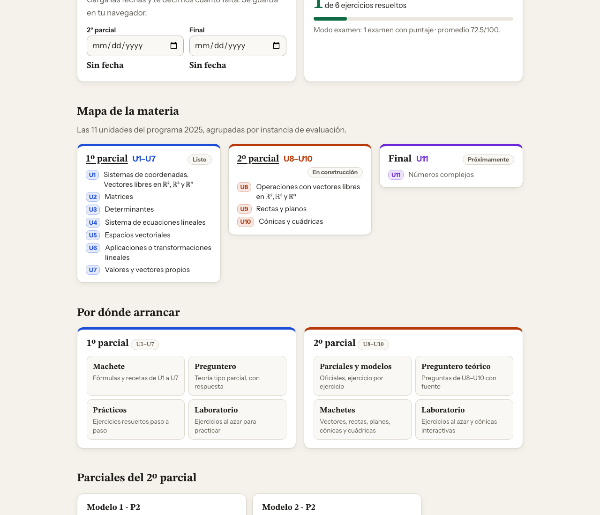

<div align="center">



# 📐 AGA · Álgebra y Geometría Analítica

### Toda la materia (UTN FRC) en un solo lugar: 1º parcial, 2º parcial y, más adelante, el final.

[](https://gabibertero.github.io/AGA/)


[🏠 Inicio](https://gabibertero.github.io/AGA/) &nbsp;·&nbsp; [1️⃣ 1º parcial](https://gabibertero.github.io/AGA/primer-parcial/) &nbsp;·&nbsp; [2️⃣ 2º parcial](https://gabibertero.github.io/AGA/segundo-parcial/)

</div>

---

## 🏠 Inicio
> La portada de toda la materia.

- 🗺️ **Mapa de la materia:** las 11 unidades del programa, agrupadas en 1º parcial, 2º parcial y final.
- ⏳ **Cuenta regresiva:** cargás la fecha del parcial y del final, y te dice cuántos días faltan.
- 📈 **Tu progreso:** ejercicios resueltos y la nota de tus últimos modo examen.
- ↩️ **Seguir donde dejaste:** vuelve al último parcial que abriste.
- 🌙 **Tema claro y oscuro.**

---

## 2️⃣ 2º parcial · U8 a U10
> Producto escalar, vectorial y mixto · Rectas y planos · Cónicas y cuádricas.

### 📄 Parciales y modelos
- ⭐ **Los 2 modelos oficiales de la profe** (Modelo 1 y Modelo 2), íntegros y en el orden original, resueltos paso a paso.
- 📝 **El parcial del curso 1R5**, con la foto del original.
- 🗂️ **Banco extra: 18 finales** con sus ejercicios de U8 a U10 (2017 a 2024), más ejercicios sueltos y relatos de alumnos.
- ✅ Cada resultado está **verificado con sympy**, y cada ejercicio dice de qué archivo y página sale.
- 📊 Gráficos de cónicas con **todos los elementos que exige la cátedra** (V/V', A/A', F/F', LL', ejes, asíntotas, directriz).

### ⏱️ Modo examen
- Cronómetro con pausa y soluciones ocultas hasta que entregás.
- Autocorrección **Bien / A medias / Mal** con criterios por ejercicio y la nota con los puntajes del parcial (30/30/40 en el Modelo 1).
- Guarda tu último intento.

### ❓ Preguntero teórico
- **53 preguntas** de U8, U9 y U10 (cónicas y cuádricas), con respuesta tipo parcial y fuente.
- Filtro por unidad, marcás **"la sé / repasar"** y armás un **simulacro teórico** de 3 preguntas, con el formato del parcial.

### 📘 Machetes
U8, U9, cónicas y cuádricas en formato **me dan → me piden → hago**, con errores comunes y qué pide la cátedra en el gráfico.

### ∑ Laboratorio
- 🎰 **Generadores** de vectores, rectas, planos y cónicas, con números nuevos cada vez, comprobación de tu respuesta (acepta `3/2`, `1,5`, `2√5`) y solución paso a paso.
- 🎛️ **Cónicas interactivas:** movés h, k, a, b o p y ves el gráfico con todos los elementos y las ecuaciones ordinaria y general en vivo.

---

## 1️⃣ 1º parcial · U1 a U7
> El sitio original del primer parcial, sin cambios: [Machete](https://gabibertero.github.io/AGA/primer-parcial/) · [Preguntero](https://gabibertero.github.io/AGA/primer-parcial/preguntero.html) · [Prácticos](https://gabibertero.github.io/AGA/primer-parcial/practicos.html) · [Laboratorio](https://gabibertero.github.io/AGA/primer-parcial/laboratorio.html)


### 📘 Machete
El resumen para tener al lado mientras estudiás: fórmulas, tarjetas *me dan → me piden → entonces*, ejercicio resuelto tipo parcial, errores comunes, frases para justificar y botón **PDF** para imprimir.

### ❓ Preguntero
> Más de 150 preguntas de teoría y práctica de todas las unidades.


| Modo | Para qué sirve |
|---|---|
| 🎲 **Práctica libre** | Filtrás por unidad, teoría o práctica, y tipo de pregunta |
| ⏱️ **Simulacro teórico** | Formato del parcial teórico (2 V/F + 2 desarrollo), con tiempo |
| ⭐ **Difíciles** | Solo las que marcaste con estrella |
| 🔁 **Mis errores** | Repasa lo que contestaste mal |

Hay preguntas de opción múltiple, varias correctas, verdadero/falso con justificación y desarrollo con respuesta modelo en notación genérica, como pide el profe.

---

### ✎ Prácticos
> Entrená el parcial práctico como es de verdad.


- 📄 **Los 3 modelos de la cátedra resueltos paso a paso.** Se revisaron las cuentas y se marcan los errores de las resoluciones originales.
- 🆕 **4 simulacros nuevos** con la estructura oficial: aplicación (35) + U5 o U6 (35) + otra unidad (30).
- 📖 **Modo estudio:** abrís cada resolución cuando querés.
- ⏱️ **Modo examen:** con cronómetro, y las resoluciones ocultas hasta que entregás.
- 🧾 **Autocorrección:** marcás *Bien / A medias / Mal* y te calcula la nota con la tabla de la cátedra.

---

### ∑ Laboratorio
> Ejercicios que no se terminan nunca, y una calculadora que te muestra cómo se hace.


#### 🎰 Generador de ejercicios
Elegís el tipo y te arma uno nuevo con otros números cada vez:

`Aplicación · Sistema 3×3` `Aplicación · Producto de matrices` `Cambio de base` `Núcleo e imagen ℝ³→ℝ²` `Núcleo e imagen ℝ³→ℝ³` `Ecuación matricial` `Inversa 3×3` `Rango` `Determinante` `Vectores` `Autovalores`

1. ✍️ Escribís tu resultado. Acepta fracciones como `8/3`, decimales con coma y raíces como `√29`.
2. ✔️ Tocás **Comprobar** y te dice qué está bien y qué revisar.
3. 👀 Tocás **Ver procedimiento** y lo ves resuelto paso a paso, con verificación.

En núcleos y autovectores acepta **cualquier** vector válido, no solo uno.

#### 🧮 Calculadora paso a paso
Cargás una matriz (de 1×1 a 6×7) en casillas grandes, elegís la operación y ves **cada operación entre filas**, con fracciones exactas:

| Operación | Cómo lo hace |
|---|---|
| Determinante | Fórmula 2×2, Sarrus 3×3 o triangulación |
| Inversa | Gauss-Jordan sobre `[A \| I]` |
| Gauss · Rango | Escalonada reducida |
| Sistema | Rouché-Frobenius: SCD, SCI o SI |
| Núcleo | Base del espacio solución de `AX = 0` |
| Autovalores | Polinomio característico, autoespacios y diagonalización |
| Transpuesta · Producto | `Aᵗ` y `A·B` |

---

## 📚 Temas

| | Unidad | Qué entra |
|:---:|---|---|
| 🔵 | **U1 · Vectores libres** | Operaciones, módulo, versor, combinación lineal, LI / LD |
| 🟢 | **U2 · Matrices** | Operaciones, inversa, ecuaciones matriciales, rango |
| 🟣 | **U3 · Determinantes** | Sarrus, cofactores, propiedades, triangulación |
| 🟠 | **U4 · Sistemas** | Gauss, Cramer, Rouché-Frobenius, sistemas con parámetro |
| 🔷 | **U5 · Espacios vectoriales** | Subespacios, bases, dimensión, coordenadas, cambio de base |
| 🩷 | **U6 · Transformaciones lineales** | Matriz asociada, núcleo, imagen, teorema de la dimensión |
| 🟩 | **U7 · Autovalores** | Polinomio característico, autoespacios, diagonalización |
| 🧭 | **U8 · Producto escalar, vectorial y mixto** | Ángulo, proyección, área, volumen, coplanaridad |
| 📏 | **U9 · Rectas y planos** | Ecuaciones, posiciones relativas, distancias, haz de planos |
| 🥚 | **U10 · Cónicas y cuádricas** | Circunferencia, elipse, hipérbola, parábola, cuádricas |
| ⏳ | **U11 · Números complejos** | Próximamente, para el final |

---

## 🚀 Cómo usarlo

**Online:** [gabibertero.github.io/AGA](https://gabibertero.github.io/AGA/). No necesitás cuenta: tu progreso se guarda en el navegador (claves `aga:v1:`).

**Plan sugerido para el 2º parcial:**
```
1. Machetes      → repasá la unidad
2. Preguntero    → probá la teoría
3. Laboratorio   → generá ejercicios hasta que salgan solos
4. Modo examen   → rendí el Modelo 1 y el Modelo 2 con tiempo
5. Banco extra   → finales de U8–U10
```

---

## 🛠️ Para desarrollar

El sitio es [Astro](https://astro.build) + MDX + KaTeX. El código está en `fuente/` y se compila a `docs/`, que es lo que publica GitHub Pages (rama `main`, carpeta `/docs`, sin Actions).

```bash
cd fuente
npm install
npm run dev        # servidor local
npm run build      # compila a ../docs (commitear docs/)
npm test           # Playwright, desktop y celular
npm run test:lab   # tests de los generadores
python3 tests/check_modelo1.py   # verificación sympy (hay un check_*.py por examen)
```

Las 4 páginas del 1º parcial viven tal cual en `fuente/public/primer-parcial/`.

---

## 🤝 Contributors

<table>
<tr>
<td align="center"><a href="https://claude.ai"><br><sub><b>Claude</b></sub></a><br><sub>alias Claudio 🤖</sub></td>
</tr>
</table>

¿Encontraste algo mal o tenés una idea? Abrí un [issue](https://github.com/gabibertero/AGA/issues) y contá en qué sección está.

---

<div align="center">

⚠️ Hecho con IA a partir de apuntes de cátedra, parciales y notas de clase.<br>
Por estudiantes, para estudiantes. Puede tener errores: usalo como **complemento** de las clases.

<br>

### Made by Claudio 🧉

<sub>Licencia [MIT](LICENSE)</sub>

</div>
