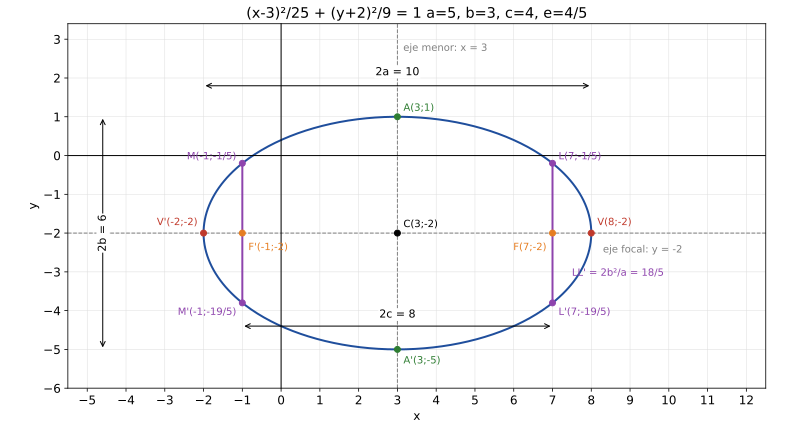
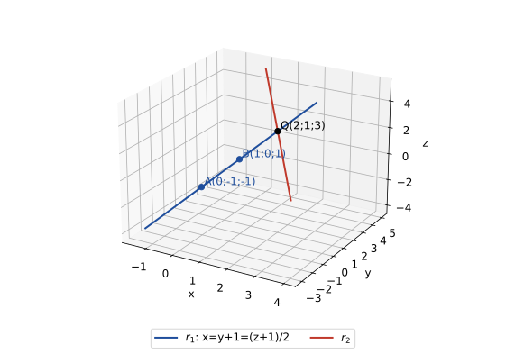

# Modelo 1 – 2.º Parcial Práctico · Álgebra y Geometría Analítica (UTN FRC)

> **Solución elaborada — no oficial, verificada con sympy** (`tests/check_modelo1.py`). El examen original no trae resolución.
> Corrección de la cátedra: primero por **resultados**; si el gráfico está mal o no es coherente con lo analítico, el ejercicio no se corrige / vale 0.

## Tabla de respuestas

| Ejercicio | Respuesta |
|---|---|
| **1** (30 pts) | Elipse horizontal: $\dfrac{(x-3)^2}{25}+\dfrac{(y+2)^2}{9}=1$. $C(3;-2)$, $a=5$, $b=3$, $c=4$, $V,V'(8;-2),(-2;-2)$, $A,A'(3;1),(3;-5)$, $F,F'(7;-2),(-1;-2)$, $e=\tfrac45$, lado recto $\tfrac{18}{5}$ con extremos $(7;-\tfrac15)$, $(7;-\tfrac{19}5)$, $(-1;-\tfrac15)$, $(-1;-\tfrac{19}5)$ |
| **2** (30 pts) | $5x-9y-8z-30=0$ (equivalente: $-5x+9y+8z+30=0$) |
| **3** (40 pts) | Simétrica de $r_1$: $\dfrac{x}{1}=\dfrac{y+1}{1}=\dfrac{z+1}{2}$ \| Posición relativa: **concurrentes (secantes)** en $Q(2;1;3)$ |

---

## Ejercicio 1 (30 pts) — Cónica $9x^2+25y^2-54x+100y-44=0$

**Paso 1. Reconocer el tipo.** Coeficientes de $x^2$ y $y^2$ de igual signo y distintos (9 y 25), sin término $xy$ ⇒ elipse (o degenerada); se confirma al completar cuadrados (Paso 3).

**Paso 2. Agrupar por variable** (para completar cuadrados cada una por separado):
$$9(x^2-6x)+25(y^2+4y)=44$$

**Paso 3. Completar cuadrados** sumando $9\cdot 9$ y $25\cdot 4$ a ambos miembros (lo que se suma adentro se multiplica por el coeficiente afuera):
$$9(x^2-6x+9)+25(y^2+4y+4)=44+81+100$$
$$9(x-3)^2+25(y+2)^2=225$$

$225>0$ ⇒ elipse real (si fuera $0$ sería un punto; si fuera negativo, vacío).

**Paso 4. Dividir por 225** para que el segundo miembro sea 1 (forma ordinaria):
$$\boxed{\frac{(x-3)^2}{25}+\frac{(y+2)^2}{9}=1}$$

**Paso 5. Leer parámetros.** Denominador mayor ($25$) bajo $x$ ⇒ eje mayor **horizontal**. $a^2=25\Rightarrow a=5$; $b^2=9\Rightarrow b=3$; $c^2=a^2-b^2=16\Rightarrow c=4$.

**Notación de cátedra (U10, p. 15):** $V,V'$ extremos del eje mayor, $A,A'$ extremos del eje menor, $F,F'$ focos, $LL'$ lado recto. El Ej. 3 usa $A$ y $B$ para otros puntos: son contextos distintos.

**Paso 6. Elementos** (siempre desde el centro $C(3;-2)$):

| Elemento | Cálculo | Valor |
|---|---|---|
| Centro | $(h;k)$ | $C(3;-2)$ |
| Vértices (extremos del eje mayor) | $(h\pm a;k)$ | $V(8;-2)$, $V'(-2;-2)$ |
| Extremos del eje menor | $(h;k\pm b)$ | $A(3;1)$, $A'(3;-5)$ |
| Focos | $(h\pm c;k)$ | $F(7;-2)$, $F'(-1;-2)$ |
| Eje mayor, eje menor, distancia focal | $2a$, $2b$, $2c$ | $10$, $6$, $8$ |
| Excentricidad | $e=c/a$ ($0<e<1$) | $4/5$ |
| Lado recto | $LR=2b^2/a$ | $18/5$ |
| Extremos del lado recto (por $F$ y por $F'$) | $x=h\pm c$, $y=k\pm b^2/a$ | $L(7;-\tfrac15)$, $L'(7;-\tfrac{19}5)$, $M(-1;-\tfrac15)$, $M'(-1;-\tfrac{19}5)$ |
| Eje focal (mayor) | recta por $C$ y los focos | $y=-2$ |
| Eje menor | perpendicular por $C$ | $x=3$ |

**Gráfico:** `docs/figuras/m1-ej1-elipse.svg` (centro, vértices, extremos del eje menor, focos, lados rectos con sus extremos, ejes de simetría, cotas 2a, 2b, 2c; ejes graduados de a 1, misma escala en x e y). Lista mínima a marcar si el parcial pide todos los elementos: $C$, $V$, $V'$, $A$, $A'$, $F$, $F'$, ejes, extremos de los lados rectos y rótulos $2a$, $2b$, $2c$.

**Comprobación.** $V(8;-2)$ en la general: $9\cdot64+25\cdot4-432-200-44=0$ ✓. $A(3;1)$: $81+25-162+100-44=0$ ✓. Además $d(A,F)=\sqrt{16+9}=5=a$ ✓ (propiedad $d_1+d_2=2a$). Lado recto: $L(7;-\tfrac15)$ en la general: $441+1-378-20-44=0$ ✓.
**Método alternativo:** ir directo a la fórmula de elipse trasladada, $h=-\tfrac{D}{2A}=3$, $k=-\tfrac{E}{2C}=-2$, y sacar $a,b$ del término independiente transformado; es lo mismo que completar cuadrados.

**Errores comunes**
- Olvidar multiplicar por 9 y por 25 lo que se suma al completar cuadrados (da $+9$ y $+4$ en vez de $+81$ y $+100$).
- Sacar $c$ como $\sqrt{a^2+b^2}$ (eso es hipérbola) o poner $a=3$ por orden de aparición.
- Colocar el eje mayor vertical, o los focos en $(3;-2\pm4)$.
- Dar los focos como $(\pm4;0)$ sin trasladar al centro.
- Graficar con escala distinta en $x$ e $y$, o no marcar el lado recto ni rotular sus extremos.
- Gráfico sin ejes cartesianos, sin focos o sin escala coherente con $C(3;-2)$.

**Rúbrica (30 pts)**

| Nivel | Criterio |
|---|---|
| **Bien** | Ordinaria correcta + C, a, b, c, V, V', A, A', F, F', e y LR (con sus extremos) correctos + gráfico con TODOS esos elementos, escala graduada y coherente con lo analítico. |
| **A medias** | Ordinaria y elementos analíticos correctos, pero el gráfico está incompleto (le falta algún elemento, p. ej. los extremos del LR o un foco) o hay un error menor de cuentas que no cambia la forma. Ojo: en el parcial real un gráfico incompleto anula el ejercicio; acá vale A medias solo como estimación de estudio. |
| **Mal** | Ordinaria incorrecta (h, k, a o b mal), eje mayor mal orientado, o gráfico faltante o incoherente con la resolución analítica. |

---

## Ejercicio 2 (30 pts) — Plano por $P(4;-2;1)$ perpendicular a $\pi_1\cap\pi_2$

**Paso 1. Idea.** Si el plano es perpendicular a la recta, el **vector director de la recta es normal al plano**. La recta $\pi_1\cap\pi_2$ está contenida en ambos planos, así que es perpendicular a $\vec n_1$ y a $\vec n_2$: su dirección es $\vec n_1\times\vec n_2$ (siempre que sea no nulo, Paso 3).

**Paso 2. Normales.** $\vec n_1=(1;-3;4)$, $\vec n_2=(2;2;-1)$.

**Paso 3. Producto vectorial** (director de la recta = normal buscada):
$$\vec n=\vec n_1\times\vec n_2=\begin{vmatrix}\vec i&\vec j&\vec k\\1&-3&4\\2&2&-1\end{vmatrix}$$
$$=\big((-3)(-1)-4\cdot2\big)\vec i-\big(1\cdot(-1)-4\cdot2\big)\vec j+\big(1\cdot2-(-3)\cdot2\big)\vec k$$
$$=(-5;\,9;\,8)$$

$\vec n\neq\vec 0$ ⇒ $\vec n_1\not\parallel\vec n_2$ ⇒ los planos no son paralelos y se cortan en una recta cuyo director es $\vec n$.

**Paso 4. Ecuación del plano** $\vec n\cdot(X-P)=0$ (pasa por $P$ con normal $\vec n$):
$$-5(x-4)+9(y+2)+8(z-1)=0$$

**Paso 5. Desarrollar:**
$$-5x+20+9y+18+8z-8=0\ \Rightarrow\ -5x+9y+8z+30=0$$
$$\boxed{5x-9y-8z-30=0}$$

Son la misma ecuación (multiplicar por $-1$ no cambia el plano): no es un error de signo.

**Respuesta:** el plano pedido es $5x-9y-8z-30=0$.

**Comprobación.** $P$: $20+18-8-30=0$ ✓. $\vec n\cdot\vec n_1=-5-27+32=0$ ✓; $\vec n\cdot\vec n_2=-10+18-8=0$ ✓.
**Método alternativo:** resolver el sistema $\pi_1,\pi_2$ parametrizando (p. ej. $z=\lambda$) y leer el director de la recta; da un múltiplo de $(-5;9;8)$.

**Errores comunes**
- Usar $\vec n_1\times\vec n_2$ como *director del plano* o tomar directamente $\vec n_1$ o $\vec n_2$ como normal.
- Error de signo en el cofactor de $\vec j$.
- Escribir $D$ mal al desarrollar: $+20+18-8$ (con $P=(4;-2;1)$, el $-2$ da $+18$).
- Dar sólo $-5x+9y+8z+30$ sin igualar a 0, o no verificar que $P$ cumple.

**Rúbrica (30 pts)**

| Nivel | Criterio |
|---|---|
| **Bien** | Plano 5x-9y-8z-30=0 (o múltiplo no nulo) con la normal (-5;9;8) justificada como director de la recta intersección. |
| **A medias** | Normal correcta pero error aritmético en D al desarrollar, o plano correcto sin justificar de dónde sale la normal. |
| **Mal** | Normal incorrecta (n1 o n2 solos, o producto vectorial mal) o plano que no pasa por P(4;-2;1). |

---

## Ejercicio 3 (40 pts) — Rectas $r_1$ (por $A$, $B$) y $r_2$

**Paso 1. Director de $r_1$:** $\vec u=\overrightarrow{AB}=B-A=(1;1;2)$ (dos puntos determinan la dirección).

**Paso 2. Paramétricas de $r_1$** (punto $A$, director $\vec u$): $x=t,\ y=-1+t,\ z=-1+2t$. Se usan en el Paso 6.

**Paso 2 bis. Ecuación simétrica** (se despeja $t$ de cada paramétrica; ninguna componente es 0):
$$\boxed{\frac{x}{1}=\frac{y+1}{1}=\frac{z+1}{2}}$$
Chequeo: $B(1;0;1)$ → $1=1=1$ ✓.

**Paso 3. Datos de $r_2$:** punto $C(3;-1;2)$, director $\vec v=(-1;2;1)$ (coeficientes de $\lambda$).

**Paso 4. ¿Paralelas?** $\vec u$ y $\vec v$ no son proporcionales ($\tfrac{1}{-1}\neq\tfrac{1}{2}$) ⇒ **no** son paralelas ni coincidentes.

**Paso 5. ¿Coplanares?** Producto mixto $[\overrightarrow{AC},\vec u,\vec v]$ con $\overrightarrow{AC}=C-A=(3;0;3)$:
$$\begin{vmatrix}3&0&3\\1&1&2\\-1&2&1\end{vmatrix}=3(1-4)-0+3(2+1)=-9+9=0$$
Producto mixto $=0$ ⇒ coplanares; como no son paralelas, **se cortan** (concurrentes).

**Paso 6. Punto de corte** (igualar las coordenadas de $r_1:(t;\,-1+t;\,-1+2t)$ y $r_2$):
$$t=3-\lambda\qquad -1+t=-1+2\lambda\qquad -1+2t=2+\lambda$$
De la 2.ª: $t=2\lambda$. En la 1.ª: $2\lambda=3-\lambda\Rightarrow\lambda=1,\ t=2$. Verifico en la 3.ª: $-1+4=3=2+1$ ✓ (el sistema es compatible determinado).
$$\boxed{Q(2;1;3)}$$

**Respuesta:** $r_1$ y $r_2$ son concurrentes (secantes) en $Q(2;1;3)$.

**Gráfico:** `docs/figuras/m1-ej3-rectas.svg`. El Ej. 3 no exige gráfico; si lo hacés, alcanza un esquema con dos rectas secantes y $Q$ rotulado.

**Método alternativo:** plantear directamente el sistema de 3 ecuaciones con 2 incógnitas $(t,\lambda)$: sin solución ⇒ alabeadas; solución única ⇒ secantes; infinitas ⇒ coincidentes. Acá da $t=2,\lambda=1$ (y de paso confirma el producto mixto).

**Errores comunes**
- Usar $A$ y $B$ como director en vez de $\overrightarrow{AB}$; escribir mal el $z+1$ en la simétrica.
- Confundir paralelismo con coplanaridad (que $\vec u\not\parallel\vec v$ **no** implica que se corten).
- Usar el mismo parámetro en ambas rectas al igualar.
- Despejar con las 2 primeras ecuaciones y no verificar la 3.ª (justamente lo que distingue alabeadas de secantes).
- Concluir "alabeadas" por un error aritmético en el determinante.

**Rúbrica (40 pts)**

| Nivel | Criterio |
|---|---|
| **Bien** | Simétrica x/1=(y+1)/1=(z+1)/2 correcta + no paralelas + se cortan justificado (mixto 0 o sistema compatible) + Q(2;1;3) con la 3.ª ecuación verificada. |
| **A medias** | Simétrica y posición relativa correctas, pero sin punto de corte, con el punto mal por cuentas, o punto correcto sin justificar la posición. |
| **Mal** | Simétrica incorrecta, o posición relativa equivocada (alabeadas o paralelas). |

---

*Solución elaborada — no oficial, verificada con sympy.*
